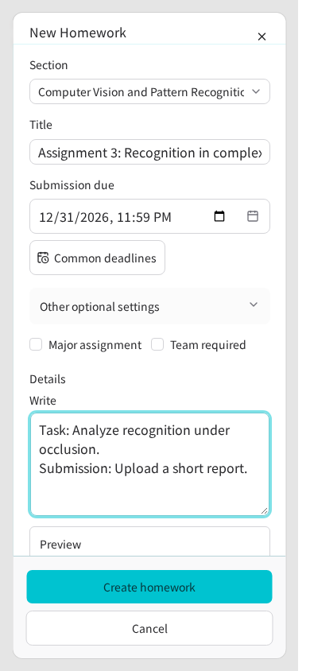
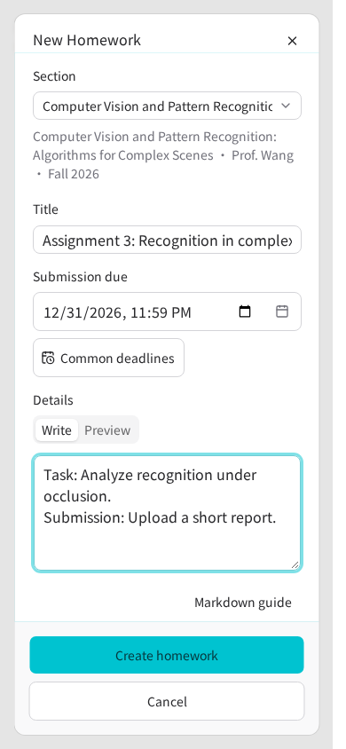
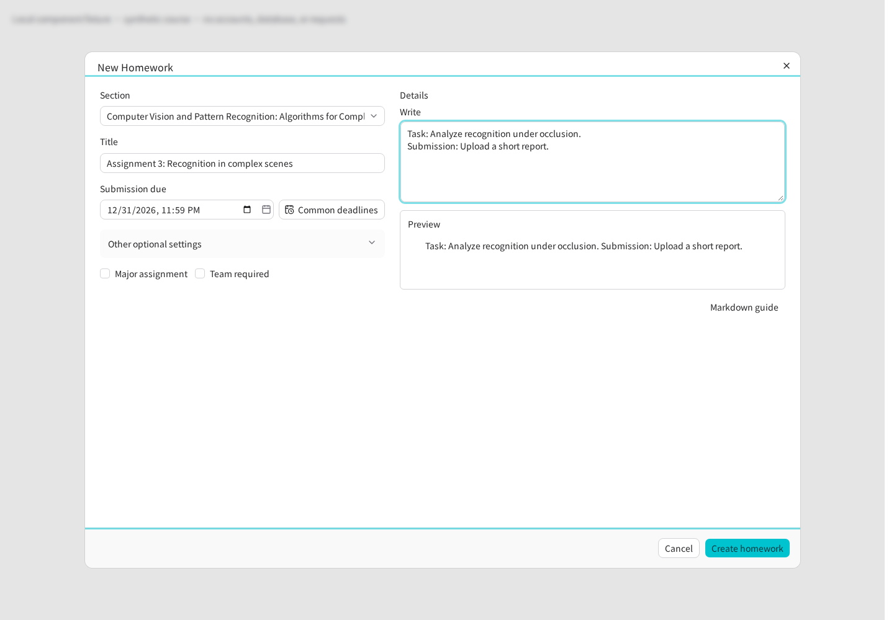
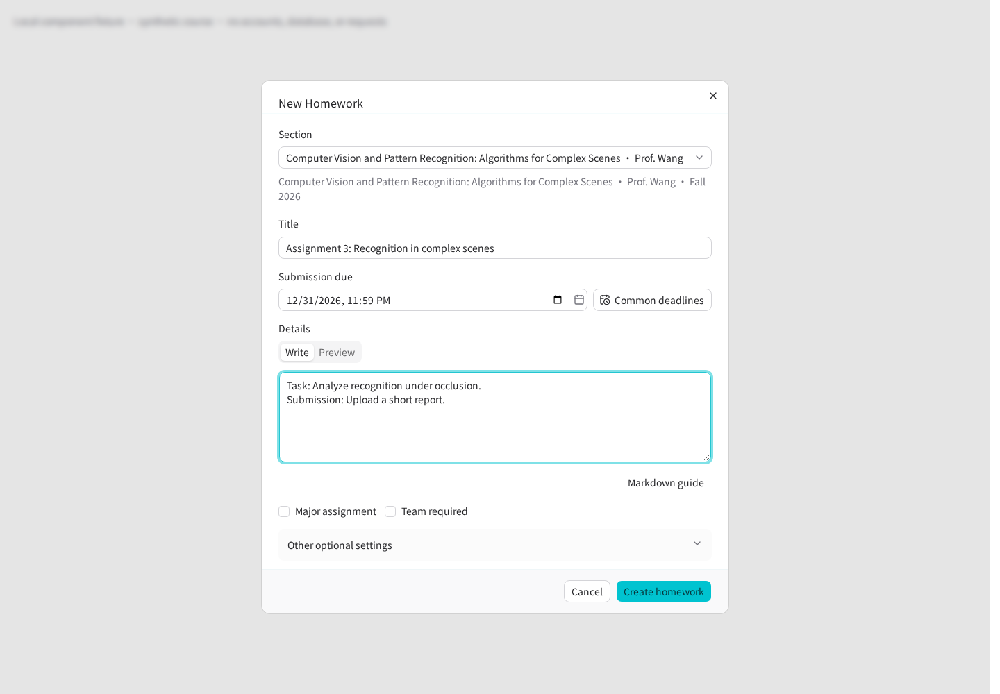
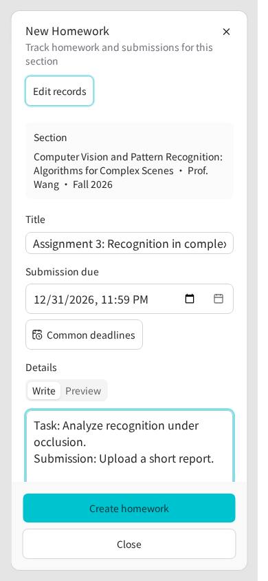
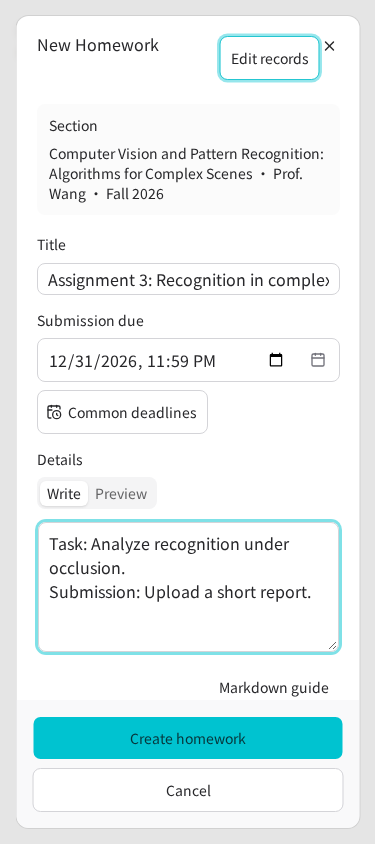

# Homework editor comparison

Related to [#1432](https://github.com/Life-USTC/server/issues/1432) and the
[model UI reference](https://github.com/Life-USTC/server/pull/1476).

The workspace and section creation entry points now render the same existing
`HomeworkEditorFields` component. Title, due date, description and major/team
flags have the same order; optional timestamps and advisory writing guidance
start collapsed. The selected workspace section has a complete wrapping summary.
The section remains fixed when creation starts from its detail page.

Both entries use the existing Shanghai-time shortcut builder. Section creation
and editing receive the section's actual schedule starts, while workspace
creation receives its selected section's existing starts. Missing schedules do
not produce invented next-class suggestions. Workspace now also offers the same
week/month and semester-start actions already available in the section editor.

Workspace compact homework details link to the canonical section URL with the
specific `homeworkId`, preserving access to the full editor and history instead
of introducing a second editing controller. Long detail context wraps, and
footer actions can wrap on narrow screens.

## Local visual observations

The images compare baseline `c81d63af79bfb670b78e5f53952c9ca4994d7c4c`
with this branch using the same synthetic section, title and description.
These are real repository Svelte components rendered with their real UI
primitives and stylesheet. Only page locale, form enhancement and the discussion
fixture are supplied locally. No account, database, authenticated request or
business write is involved; these observations do not establish full Web or
production acceptance.

The implementation was compared with the prototype before visual review.
English and Chinese at 390, 768 and 1440 pixels covered workspace creation,
section creation and workspace detail. The 18 local renderings had no page
exceptions; dialog and scroll-viewport scroll/client widths matched. Representative
images were also inspected for complete context text and control boundaries.
Both creation entries exposed the
same 12 available shortcut labels for the matched schedule, expanded optional
timestamps and naming guidance, and retained the entered title, description,
due date and checked major flag in native FormData. The workspace alone included
the selected section identifier. Detail links retained the exact synthetic
homework identifier and `#homework` anchor.

Screenshots support review of text hierarchy and bounds. Actual permission
projections, persisted create/edit/completion flows, production navigation and
the remaining #1432 outcomes require the full application checks.

| Entry / viewport  | Before                                                         | After                                                        |
| ----------------- | -------------------------------------------------------------- | ------------------------------------------------------------ |
| Workspace, 390px  |    |    |
| Workspace, 1440px |  |  |
| Section, 390px    |        |        |

Additional observations: [full-details link and footer](after-detail-en-us-390.png)
and [the bounded deadline menu](after-workspace-en-us-390-deadlines.png).

A focused follow-up retained the section's actual audit-record header button.
Both mobile creation footers occupy y=700–828 inside the 844px viewport, with
Create and Cancel readable. After scrolling through the optional fields and
opening the shortcut menu, choosing the next actual class set both entries to
`2026-11-09T08:00` in Shanghai time. The menu occupied x=0–287 inside the 390px
viewport, with equal scroll/client widths. These are local component observations.

## Retained CI failure and correction

Run [42177828959](https://github.com/Life-USTC/server/actions/runs/42177828959)
at `0d90f69c` exposed one unit failure and three Homework browser failures.
The original run and artifacts remain retained; no unchanged rerun replaced them.

The new full-details action omitted the explicit medium-breakpoint minimum
height required by the shared Button base. It now retains that height. Its
horizontal mobile placement also squeezed the completion action to 139px in the
original 320px browser case. Mobile detail actions now stack at full width;
the existing test's 240px minimum assertion remains unchanged. The local actual
component correction measures the primary action at 288px × 44px, with its
footer ending at the 568px viewport boundary. See [the 320px correction](repair-detail-320.png).

The two creation cases still expected a permanently visible split preview and
two desktop form columns. The shared single-column/tab design replaces those
presentation assumptions. The original cases now switch Preview → Write →
Preview, retain heading/strong-content update and hidden-input assertions,
check the single-column geometry, and keep every persisted-create and effects
assertion. No case, deadline, mutation or audit assertion was removed. Local
actual-component checks at 1280/390px verified both rendered revisions and the
unchanged description form value; see [the 390px preview](repair-preview-390.png).
The preview image waits for the actual finite tab transitions to finish. The
product stylesheet, including the shadcn `data-active` custom variant, is loaded
unchanged. DOM state and final computed styling agree: Preview is selected with
a white background and shadow, while Write is unselected. An earlier visual
observation captured an intermediate transition frame; it did not establish a
product tab-state or stylesheet defect. No product tab primitive was changed.
The responsive minimum-height unit test also passes after the correction.
Full database-backed browser acceptance remains the CI gate.
