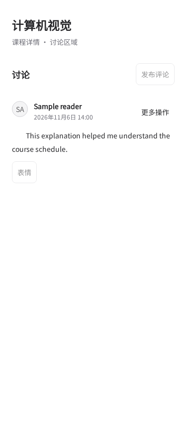
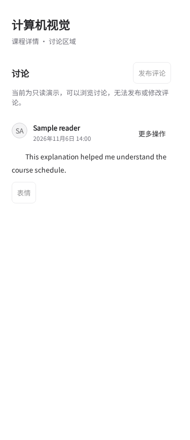

# Read-only comment explanation

Matched 390 × 900 Chromium renders of the actual CommentsPanel with the same
complete, synthetic public-comment initial data. Before uses main `c81d63af`;
after uses this PR. The reason was previously only a disabled button tooltip
when comments existed; it is now readable below the action without hovering.

| Before                | After               |
| --------------------- | ------------------- |
|  |  |

The empty and populated discussion were also inspected in Chinese at 390 px
and English at 1024 px. Afterward the reason appears once, and the disabled
button's aria-describedby resolves to that visible paragraph. No API requests,
non-GET requests or page errors occurred. Fonts were supplied only by the local
review harness. These are component observations, not production acceptance or
proof of authentication and persistence.
