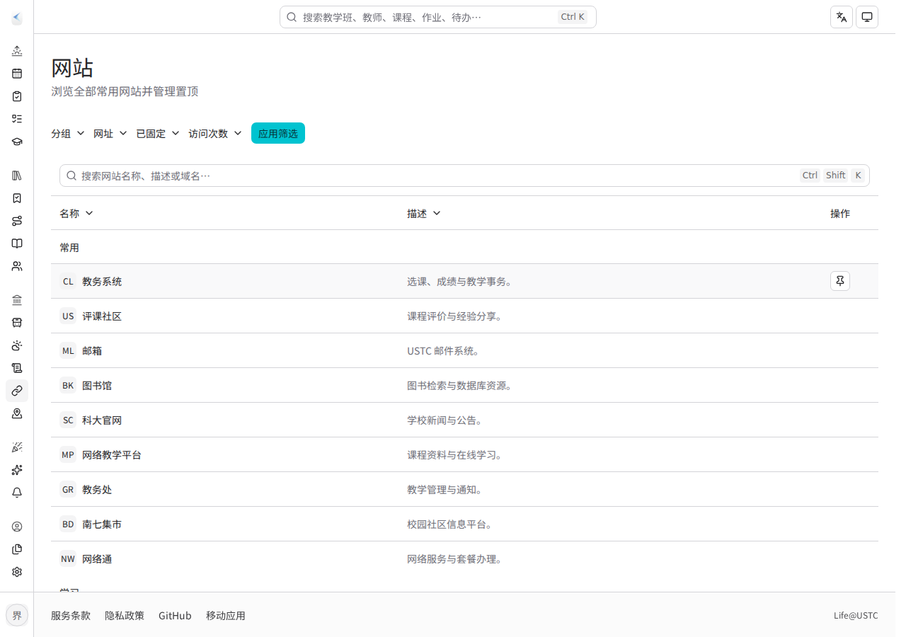
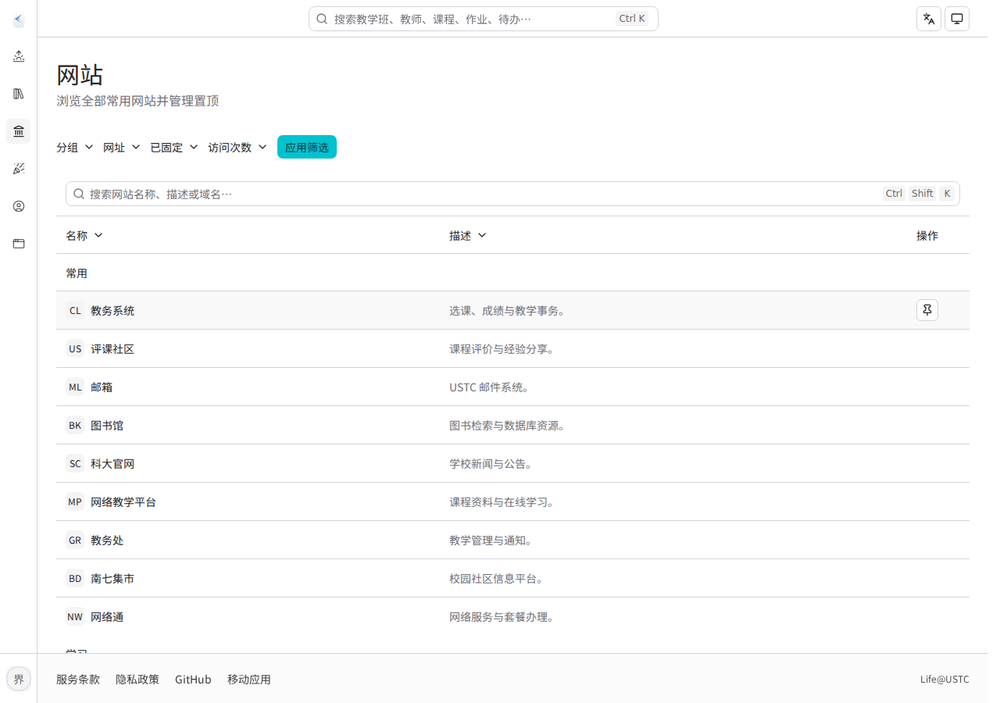
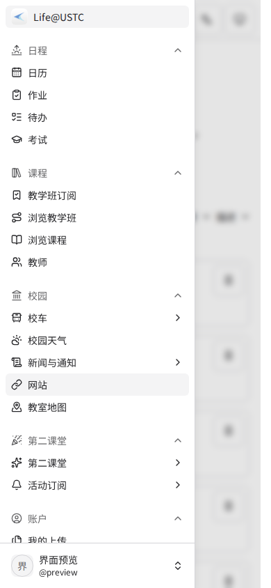
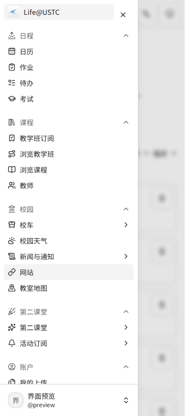
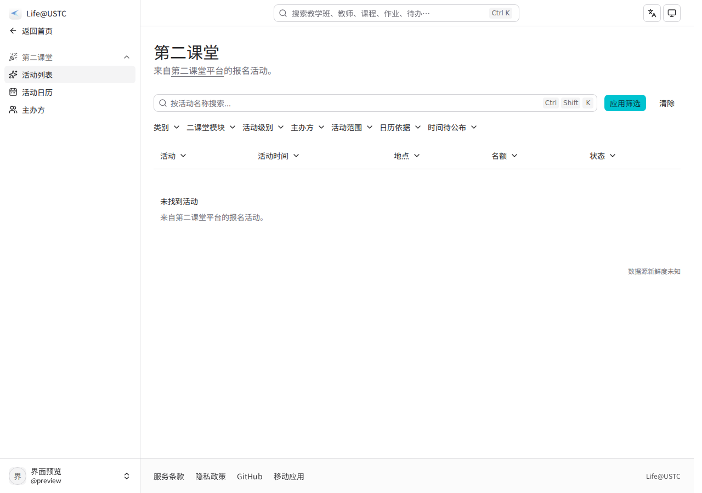
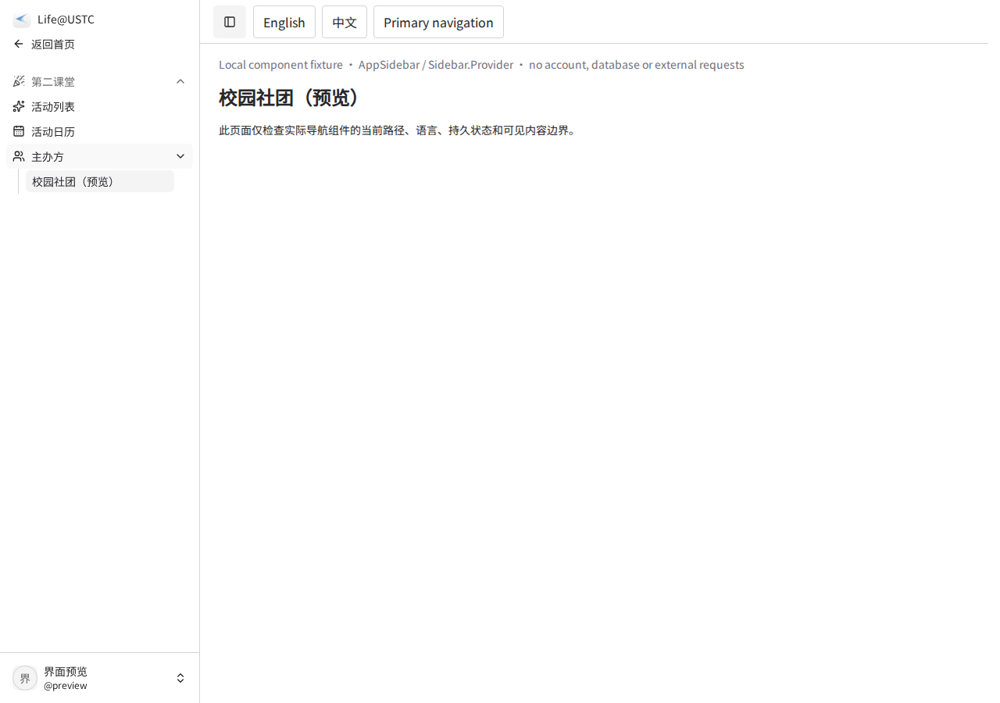
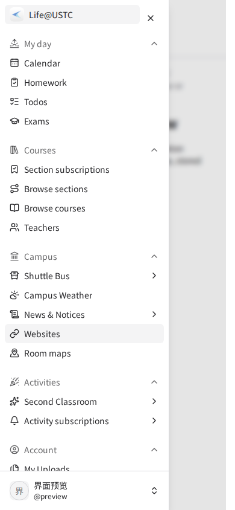

# Sidebar navigation review

Part of [#1426](https://github.com/Life-USTC/server/issues/1426).

## Interaction design

- Keep the Life@USTC root identity and explicit parent destination when focusing
  settings, second-classroom or administration sections. Route links retain
  SvelteKit client navigation; the sidebar is not a separate application.
- Store the desktop rail and disclosure choices on the device using static
  group/destination identities. Store no viewer, entity name, record identifier,
  count or permission. The current route's ancestors open for orientation;
  saved collapse choices apply to other groups.
- A compact rail shows one named icon per intent group. The active group keeps
  the current-location highlight; choosing an icon expands its destinations.
- A mobile drawer has a localized dialog name and a visible 44px close action.
  Dismissal returns focus to the menu trigger.

References: [Vercel navigation](https://vercel.com/changelog/new-dashboard-navigation-available)
uses consistent navigation across contexts;
[Cloudflare account/zone navigation](https://developers.cloudflare.com/fundamentals/concepts/accounts-and-zones/)
provides an explicit way back to the parent scope. The local persistence and
specific groups above are Life@USTC decisions.

## Matched captures

Original Chromium screenshots, captured at 1280×900 and 390×844 respectively.
The baseline is main `c81d63af`. Both sides use the same public Links page,
Chinese locale and isolated viewer fixture.

| State                | Before                                             | After                                            |
| -------------------- | -------------------------------------------------- | ------------------------------------------------ |
| Compact desktop rail |  |  |
| Open mobile drawer   |   |   |

The second-level context preserves the site identity and parent route:

## Observed behavior and scope

The actual SvelteKit application, shell and sidebar components ran in Chromium
153.0.8010.0. The browser supplied a deterministic shell-bootstrap/viewer HTTP
response; an isolated Vite plugin supplied public Young page-load records. No
fixture code is delivered. These checks establish presentation and navigation,
not session authentication, database isolation or production latency. A same-origin
QA font supplied the host's missing Chinese glyphs; no layout CSS was overridden.

Observed in the candidate:
- A compact desktop rail survived a document reload. Selecting Campus expanded
  the rail, and the current ancestor remained identifiable.
- The browser entered Young activities, organizers and an organizer detail,
  used the explicit parent link home, and traversed back to the originating
  Links page. A document marker survived and the document-request count was
  unchanged at the context-navigation checkpoint, before any later reload.
- A deliberately collapsed non-current Apps group survived context return and
  a later document reload.
- At 390px, the drawer was named 主导航; its close target measured at least
  44×44px. Both the visible close action and Escape dismissed it and returned
  keyboard focus to the menu trigger.
- The mobile navigation content fit its 280px viewport in the additional check.

Reviewing the organizer capture revealed a separate prefix bug: the activity
list was incorrectly highlighted as an ancestor of its calendar/organizer
siblings. The navigation predicate now distinguishes those siblings, with an
assertion in the existing navigation unit case.

A full-application follow-up was stopped by automatic approval review because
Miniflare startup could contact external `workers.cloudflare.com`. That denied
operation was not repeated. Read-only dependency inspection identified the
simulated `Request.cf` data fetch; the remaining checks used a separate renderer
with the real `AppSidebar`, `Sidebar.Provider` and navigation builders, only
Svelte/Tailwind plugins, no SvelteKit/Cloudflare adapter or business session, and
all non-local browser requests blocked. This narrower check complements the
actual-app evidence above; it does not complete the blocked full-app follow-up
or establish authentication/production acceptance.

The supplemental local component check passed organizer single-current/parent
highlighting, English copy and disclosure/rail preferences across reload,
English mobile naming/Escape focus, and visible navigation/control bounds at
768/1024px. No external browser request or page error occurred.

| Width | Document client / scroll | Navigation client / scroll | Main content client / scroll |
| ----- | ------------------------ | -------------------------- | ---------------------------- |
| 768   | 768 / 753                | 255 / 255                  | 497 / 497                    |
| 1024  | 1024 / 1009              | 255 / 255                  | 753 / 753                    |

All 53 visible navigation labels/controls fit inside the navigation bounds.
The rail's hit area extends from x=251 to 275 into the intended gutter, while
navigation controls and document/main content retain their full visible width.

The original raw QA report sampled one numeric document count after a later
reload; that number is not used as context-navigation evidence. The actual-app
marker/count assertions above occurred before the reload and passed.

Existing navigation tests retain dialog role and localized-name locators. No new
browser scenario or visual-shape constraint was added. Local navigation unit tests
and specification validation pass; the complete local type/static/build checks
and current-head CI remain required before merging. The first full typecheck
attempt exceeded this environment's default Node heap.

The larger #1426 work on canonical entity parents, in-page section navigation
and page/footer templates remains open.
